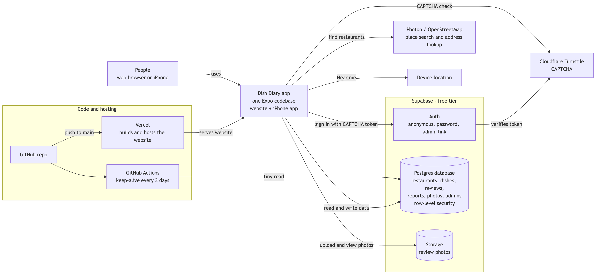
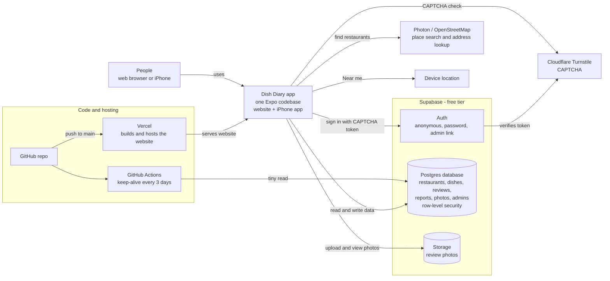

# Dish Diary

See which dishes people liked (and which to skip) at restaurants near you.
One Expo codebase runs as a website (Vercel) and as an iPhone app.

**Stack:** Expo + Expo Router (TypeScript) · Supabase (Postgres + RLS, Auth, Storage) · Cloudflare Turnstile (CAPTCHA) · Photon / OpenStreetMap (place search) · Vercel (web hosting)

## Architecture



<details>
<summary>Diagram source (Mermaid)</summary>

Edit this, then regenerate the image with
`npx -y @mermaid-js/mermaid-cli -i arch.mmd -o doc/architecture.png -w 1600 -s 2 -b white`
(after saving the block below as `arch.mmd`).



</details>

| Piece | What it does | Free-tier notes |
|---|---|---|
| **Expo app** (`src/`) | One TypeScript codebase: website via `expo export`, iPhone app via Expo Go / `expo run:ios` / EAS | — |
| **Vercel** | Builds the web app from GitHub on every push to `main` and serves it (`vercel.json`) | Hobby plan, non-commercial |
| **Supabase Auth** | Anonymous accounts (after CAPTCHA), optional email + password accounts, admin magic-link sign-in | Built-in email only reaches project team addresses |
| **Supabase Postgres** | All data; security enforced in the database with RLS, column grants and triggers (`supabase/`) | 500 MB; pauses after ~7 idle days (hence keep-alive) |
| **Supabase Storage** | Review photos, shrunk on the device before upload | 1 GB storage, 5 GB egress / month |
| **Cloudflare Turnstile** | CAPTCHA before anyone can post or sign in; Supabase checks each token with the secret key | Free |
| **Photon / OpenStreetMap** | "Find the restaurant" search and address → coordinates for Near me; called directly from the app, no key | Fair use; credit "© OpenStreetMap contributors" |
| **Device location** | Location for nearby search results and Near me; asked only when used | — |
| **GitHub Actions** | `keep-alive.yml` pings the database so the free project doesn't pause | Free |

**What happens when someone posts a review:** the app shows Turnstile → gets a one-time token →
Supabase Auth checks it with Cloudflare and creates an anonymous session (or the person signs in) →
the review is written straight to Postgres, where RLS makes sure it's tied to that session and only
its author (or an admin) can change it → photos are resized on the device and uploaded to Storage
under the author's own folder.

## Project layout

```
src/app/                 screens (Expo Router: every file is a route)
  index.tsx              restaurant list, search, cuisine filter
  restaurant/new.tsx     add a restaurant
  restaurant/[id].tsx    dishes grouped Must try / Mixed / Skip (two panes on wide screens)
  dish/[id].tsx          one dish's reviews (phone)
  about.tsx              privacy + community rules
src/components/          UI pieces (app-shell = sidebar / bottom nav, turnstile, review form…)
src/lib/                 supabase client, auth, theme + breakpoints, types
supabase/schema.sql      tables, security rules, rate limits, auto-hide on reports
.github/workflows/       keep-alive ping so the free Supabase project doesn't pause
```

## Layout by screen width

| Width | Layout |
|---|---|
| < 700px (phone) | single column, bottom navigation |
| 700–1099px (tablet) | sidebar; restaurant page shows dish list + reviews side by side |
| ≥ 1100px (desktop) | same, restaurant cards in 3 columns, content capped at 1100px |

Breakpoints live in `src/lib/theme.ts` (`useBreakpoint`).

## One-time setup

1. **Database:** Supabase → SQL Editor → New query → paste `supabase/schema.sql` → Run.
2. **Auth:** Supabase → Authentication → enable *Anonymous sign-ins* and *CAPTCHA (Turnstile)* with your Turnstile **secret** key.
3. **Keys:** fill in `.env` (copied from `.env.example`). Only public keys go here.
4. **Existing projects only:** run any files in `supabase/migrations/` that you haven't run yet
   (SQL Editor → paste → Run). `schema.sql` already includes them for new projects.

## Restaurant lookup

"Find the restaurant" on the add form searches [Photon](https://photon.komoot.io)
(free OpenStreetMap search by komoot — no key or account). Results are limited to ~30 km
around the visitor when they share location, falling back to everywhere if nothing matches.
Picking a result fills name, street and city and stores the OpenStreetMap id (`osm_id`) so the
same place can't be added twice. The public instance is fair-use and throttles heavy traffic;
results must stay credited "© OpenStreetMap contributors". Code: `src/lib/place-lookup.ts`.

## Run locally

```bash
npm install
npx expo start        # press w for web, or scan the QR code with Expo Go on your iPhone
```

## Deploy the website (Vercel)

1. Push this repo to GitHub.
2. Vercel → Add New → Project → import the repo (settings come from `vercel.json`).
3. Vercel → Project → Settings → Environment Variables: add the `EXPO_PUBLIC_*` values from `.env`.
4. Add the Vercel hostname to your Turnstile widget's hostname list.

## Keep Supabase awake

GitHub repo → Settings → Secrets and variables → Actions → add `SUPABASE_URL` and `SUPABASE_KEY`.
The workflow pings the database every 3 days. (GitHub disables scheduled workflows after 60 days
without commits — re-enable it from the Actions tab if that happens.)

## Install on your own iPhone (free, by cable)

Needs Xcode + CocoaPods. With the phone plugged in and Developer Mode on:

```bash
npx expo run:ios --device --configuration Release
```

Free Apple IDs: the app expires after 7 days; re-run to reinstall.

## Photos on reviews

Anyone who has passed the CAPTCHA can attach up to 3 photos to their review (library or camera).
Photos are shrunk on the device before upload — ≤1280 px JPEG at 70% (~150–250 KB) plus a
≤400 px thumbnail (~25 KB) — which also strips EXIF/GPS. Lists load thumbnails only; tapping opens
the full photo. At ~250 KB per photo the free 1 GB holds roughly 4,000 photos.

Enforced server-side (migration `005_photos.sql`): bucket `review-photos` is public-read, 1 MB per
file, JPEG only; uploads only into the uploader's own folder; 3 photos per review and 10 per person
per 24 h. Files are deleted through the Storage API whenever their review, dish or restaurant is
deleted. Admin page shows photo count/MB; the Excel export has a Photos sheet.
Code: `src/lib/photos.ts`, `src/components/review-form.tsx`, `src/components/photo-viewer.tsx`.

## Near me

"📍 Near me" on the main page lists reviewed restaurants within 2/5/10/25 miles of the visitor,
nearest first (straight-line distance). Restaurants store `lat`/`lng` (migration
`004_location.sql`): from the map-search pick, or by looking up the typed address when saving;
admin address edits re-locate. Restaurants without coordinates don't appear in Near me — fix one
by editing its address as admin. Code: `src/lib/location.ts`, `src/app/index.tsx`.

## User accounts (optional for visitors)

Anyone can still post without signing up (anonymous account after a CAPTCHA). Visitors can also
create an email + password account at `/account` (CAPTCHA protected): their account name fills
"Your name" on every form, and they can edit or delete their reviews from any device. The name
is stored on the account (`user_metadata.display_name`) — no database table.

Supabase setting: Authentication → Sign In / Providers → Email → **Confirm email off** (the
built-in email can't reach regular users). Consequences: emails aren't verified, and there are no
password-reset emails — reset a password from Authentication → Users, or add custom SMTP later.
Code: `src/app/account.tsx`, `src/lib/auth.tsx`.

## Admin mode

Admins sign in at `/admin` (link at the bottom of About) with an emailed sign-in link, then see
Edit / Hide / Delete on every restaurant, dish and review (hidden ones too, with a badge), a
Reports list, and **Download Excel file** (one workbook: Restaurants, Dishes, Reviews, Reports;
web only). Code: `src/app/admin.tsx`, `src/components/admin-tools.tsx`, `src/lib/export.ts`.

Setup (once):
1. Run `supabase/migrations/003_admin.sql` in the SQL Editor.
2. Authentication → **URL Configuration**: Site URL = the Vercel address; add
   `https://<your-site>/**` and `http://localhost:8081/**` under Redirect URLs.
   (Supabase's default email template is used as-is — free projects can't edit it.)
3. Authentication → Users → **Add user → Create new user** with your email (auto-confirm on).
   Supabase's built-in email only delivers to your project team's addresses and a few per hour.
4. SQL Editor: `insert into public.admins (user_id) select id from auth.users where email = 'you@example.com';`

Only accounts in `public.admins` get admin rights; the sign-in never creates accounts.

## Moderation

- Reports: Supabase → Table Editor → `reports`.
- Anything reported by 3 different people is hidden automatically (`is_hidden = true`). Set it back to `false` to restore.
